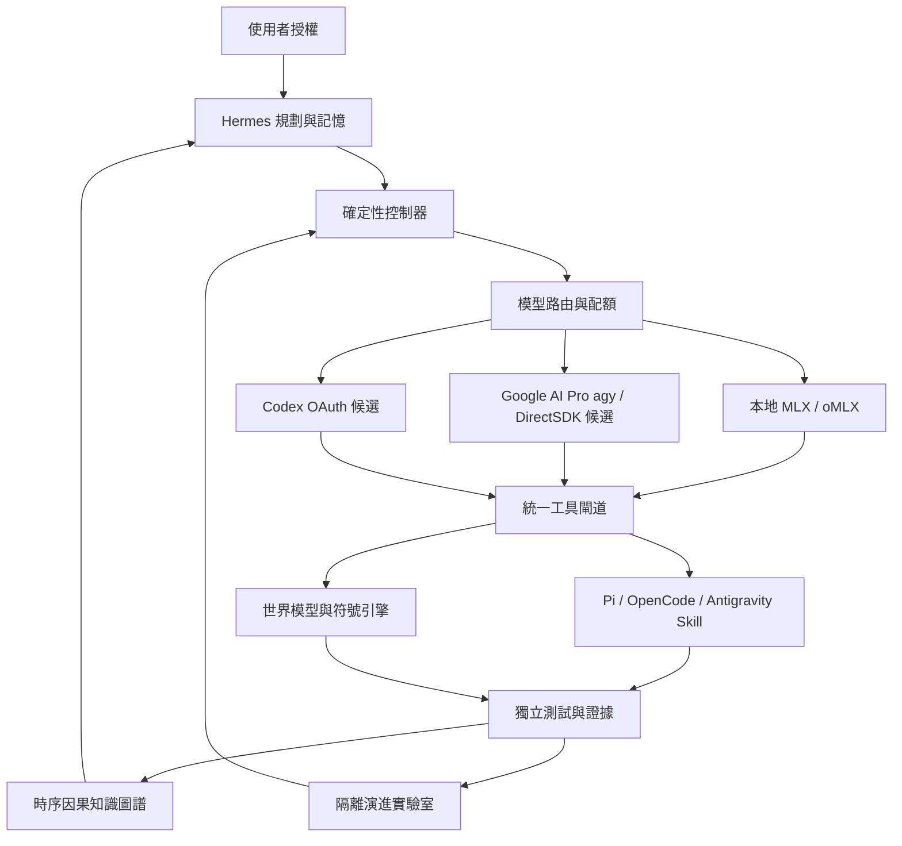

# OpenCognitiveOS｜開放認知作業系統

[English](README.md)

**狀態：架構研究與原型規劃，尚未完成部署。**

以地端優先、異質模型、世界模型、可驗證工程與受控自我演進為核心。初期目標為 Apple Silicon，支援離線運作，額外 API 預算預設為零。

## 架構 v8.4

## 核心原則

- 單一控制權：SQLite 持久化任務、租約、fencing、outbox、資源及權限治理。
- 動態稀疏拓撲、受控遞迴、父目標注入；簡單任務退回單 Agent。
- 五維資訊：跨專案、目標層級、抽象深度、時間版本、因果假設。執行依賴必須為 DAG。
- 聯邦世界模型：軟體、物理、金融、運算、知識及制度；觀測、信念狀態、預測與真實回饋分離。
- LLM 提案，符號工具及真實測試驗證。證據綁定 commit SHA；未驗證知識不得升級。
- 雲端逐任務授權；禁止額外付費、自動購買額度、憑證洩漏及未授權資料傳輸。Marketplace 上架不代表 Google 授權。agy/DirectSDK 尚待配額、條款及隔離測試。
- 自我演進僅在隔離環境進行，正式升級須驗收及授權。禁止自動修改主分支或部署。

## 參考專案與研究

- [Hermes Agent](https://github.com/NousResearch/hermes-agent)：模型、記憶、技能與委派。
- [Pi](https://github.com/badlogic/pi-mono)：精簡 coding harness。
- [OpenCode](https://github.com/anomalyco/opencode)：多模型程式開發。
- [OpenHands](https://github.com/OpenHands/OpenHands)：ACP、遠端工作區及控制台候選。
- [mini-SWE-agent](https://github.com/SWE-agent/mini-swe-agent)：最小基線。
- [Harness Engineering](https://arxiv.org/abs/2609.00006)：十一套 coding harness 原始碼比較（預印本）。
- [Coding-Agent Harness Study](https://github.com/SteveVitali/coding-agent-harness-study)：固定 commit 的比較研究。
- [G-Memory](https://arxiv.org/abs/2506.07398)、[RLM](https://arxiv.org/abs/2512.24601)、[V-JEPA 2](https://github.com/facebookresearch/vjepa2)：記憶、遞迴、世界模型候選，尚無整合實驗。

以上是設計參考，未複製上游程式碼，版本、授權與相容性須逐項驗證。

## 開發階段

P0：最小 mock harness、任務契約、持久化與權限測試。P1：地端模型及 coding worker。P2：雲端 Provider 受控接入、額度與工具隔離。P3：世界模型、時序知識及遞迴。P4：獨立評估、動態拓撲與演進。每階段以等資源基線比較；未完成實測不可宣稱正式支援。
